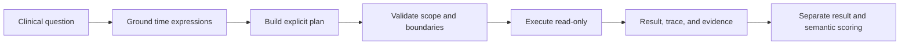

# Clinical Temporal Reasoning Agent

Clinical database questions often look simple until time becomes part of the specification. A query may need to distinguish a calendar month from a rolling window, select an event before applying an outcome filter, clip an ICU window at discharge, preserve half-open boundaries, or identify a readmission in a different encounter. Small mistakes in any of these choices can produce valid SQL with the wrong cohort.

This project implements a local, inspectable temporal-reasoning pipeline for clinical database questions. It converts supported time language into explicit intervals and versioned plans, validates every plan before execution, and runs the plan against a read-only SQLite database with row-level evidence and an execution trace. The package does not call a language-model API.

## What we built

### Deterministic temporal grounding

The temporal layer converts supported expressions into explicit timestamp bounds. A grounded window records:

- its start and end timestamps;
- whether each endpoint is inclusive or exclusive;
- the reference timestamp used for relative language;
- whether the phrase represents a calendar period or an elapsed interval; and
- the original text span and normalization policy.

The implementation covers absolute dates and years, named calendar periods, relative calendar expressions, rolling elapsed windows, offsets, and one-sided constraints. Calendar weeks begin on Monday. Month and year shifts clamp safely at the end of shorter months. Relative expressions require a caller-supplied reference timestamp and never read the system clock.

For example, `last month` at a reference time of January 15, 2026 becomes the half-open interval `[2025-12-01, 2026-01-01)`:

```bash
temporal-agent parse "admissions last month" \
  --reference-time 2026-01-15T00:00:00
```

### A closed temporal plan language

Questions are represented as versioned JSON plans rather than hidden control flow. Version 1 has five operations:

| Operation | Purpose |
|---|---|
| `fetch` | Retrieve a supported event type with declared identifiers and filters. |
| `filter_time` | Apply an explicit absolute time window. |
| `select` | Select an ordinal event with a declared direction and partition. |
| `within` | Relate candidate events to an anchor with explicit bounds and encounter scope. |
| `answer` | Produce the requested count, existence flag, timestamps, or records. |

Plan validation rejects unknown operations, undeclared inputs, invalid or reversed windows, unsupported filters, duplicate step IDs, dangling references, and unused branches. A relative join must state whether it applies to the same encounter, a different encounter, or any encounter. This prevents an unstated encounter assumption from silently entering the result.

The following command constructs an explicit first-readmission plan:

```bash
temporal-agent readmission-plan \
  --reference-time 2026-01-15T00:00:00 \
  --days 30 \
  --subject-id 1001
```

The resulting plan selects the first discharge, searches for admissions in `(0, 30]` days, requires a different encounter, and then selects the first qualifying readmission per anchor.

### Conservative natural-language planning

The included rule planner supports a deliberately bounded set of admission and discharge questions. It recognizes supported time expressions, event ordinals, patient identifiers, selected admission filters, and count/existence/timestamp answers.

```bash
temporal-agent plan \
  "How many admissions did patient 1001 have last month?" \
  --reference-time 2026-01-15T00:00:00
```

The planner fails closed when a question contains unsupported vocabulary, multiple ambiguous event scopes, unresolved temporal operators, or conditions it cannot bind safely. It does not emit a partial plan and pretend the entire question was understood. More complex questions can be represented directly in the plan language and passed to `execute-plan`.

### Read-only execution with evidence

The executor opens SQLite databases in read-only mode and enables `query_only`. Each plan step reports its output row count, and fetch steps also report the parameterized SQL used to retrieve source events. Final results include row-level evidence with event identifiers, patient and encounter identifiers, timestamps, and anchor lineage.

Execution preserves several temporal safeguards:

- ordinal selection is partitioned explicitly by patient or anchor;
- repeated appearances of the same event do not become separate admissions;
- ties at an ordinal cutoff raise an error instead of inventing a row-ID tie break;
- same/different encounter rules require known encounter identifiers;
- relative joins preserve the anchor lineage that produced each match; and
- row limits fail with an error rather than silently truncating a result.

```bash
temporal-agent execute-plan plan.json \
  --database clinical.sqlite \
  --max-rows 50000
```

### Provenance-aware local data import

The importer creates a new SQLite database from explicitly selected CSV or CSV.GZ tables. It validates required identifiers, imports supported columns in batches, creates patient indexes, and stores a manifest containing the dataset identifier, source paths, row counts, and imported columns.

```bash
temporal-agent import-csv ./csv \
  --database clinical.sqlite \
  --dataset-id local-mimiciv-extract \
  --tables admissions patients labevents icustays
```

The destination must not already exist. A failed import is rolled back and the incomplete database is removed.

### Safe SQL and evaluation utilities

The repository also contains utilities used to evaluate temporal SQL systems:

- a conservative BigQuery lexical gate that permits a single `SELECT`/`WITH` statement and rejects external, procedural, remote-routine, and multi-statement execution;
- authoritative BigQuery dry-run checks for statement type, referenced tables, and routines;
- read-only SQLite SQL evaluation with an authorizer, row limit, and virtual-machine step limit;
- exact result-shape validation, including column names and order, row multiplicity, NULL handling, integer precision, string case, and declared numeric tolerances;
- explicit separation of result correctness, temporal correctness, and template alignment;
- denominator accounting that retains generation, SQL, budget, and execution failures rather than silently dropping them; and
- evidence-backed semantic adjudication bound to hashes of the question, SQL, and rubric so stale reviews cannot be reused after an input changes.

Result equality is never treated as proof of temporal correctness. Temporal semantics require independent labels or evidence-backed adjudication.

## Design principles



The implementation follows five principles:

1. **Make boundaries visible.** Every interval states its endpoint policy.
2. **Make scope visible.** Selection partitions, anchors, and encounter relationships are declared.
3. **Fail closed.** Unsupported or ambiguous semantics produce an error instead of a guessed query.
4. **Preserve evidence.** Results retain the events and anchors that produced them.
5. **Score separate claims separately.** Correct output, correct temporal semantics, and template alignment are distinct axes.

## Installation

Python 3.10 or newer is required. The core package has no third-party runtime dependencies.

```bash
git clone https://github.com/Levilixinyu/temporal-reasoning.git
cd temporal-reasoning
python -m pip install -e .
```

The CLI is then available as either `temporal-agent` or `python -m temporal_agent`.

## Command reference

| Command | Description |
|---|---|
| `parse` | Extract and ground supported time expressions without claiming full-question coverage. |
| `plan` | Build a validated plan for a supported admission/discharge question. |
| `query` | Plan and execute a supported question against a read-only SQLite database. |
| `readmission-plan` | Build a first-readmission plan with an explicit elapsed-day window. |
| `execute-plan` | Validate and execute a JSON plan against a read-only database. |
| `import-csv` | Import supported CSV tables into a new provenance-tracked SQLite database. |

Run `temporal-agent <command> --help` for command-specific arguments.

## Repository structure

```text
temporal_agent/
  temporal.py                    deterministic temporal grounding
  temporal_*_patterns.py         duration, event, and question semantics
  plan.py                        closed plan schema and validation
  planner.py                     conservative rule planner
  executor.py                    read-only plan execution and evidence
  database.py                    provenance-aware CSV import
  bigquery_readonly.py           BigQuery SQL and dry-run safety checks
  benchmark_scoring.py           strict output-contract comparison
  evaluation.py                  read-only SQL result evaluation
  semantic_adjudication.py       evidence and hash-bound review validation
  cli.py                         command-line interface
tests/                            113 unit tests
```

## Testing

```bash
python -m unittest discover -s tests
```

The test suite covers calendar and elapsed-time semantics, leap days, endpoint combinations, ordinal selection and ties, encounter scope, clipped ICU and hospital windows, duration bins, readmission logic, read-only execution, output comparison, failure denominators, and semantic-review integrity.

## Current scope and limitations

- The natural-language planner is a conservative baseline, not a general clinical question-answering system.
- Supported event and filter vocabularies are intentionally closed and versioned.
- Database timestamps are treated as naive dataset-local values. Timezone-aware inputs require an explicit adapter.
- Complex clinical definitions, code sets, units, missing-value policies, and event-linkage rules must be supplied explicitly; the package does not invent them.
- The package can validate and execute explicit plans that are richer than the questions recognized by the rule planner.
- MIMIC-IV source data, benchmark question banks, model outputs, execution logs, review records, and credentials are not included in this public repository.

This repository is intended as a transparent foundation for temporal reasoning experiments and auditable clinical query workflows. It is not a clinical decision-support system.
